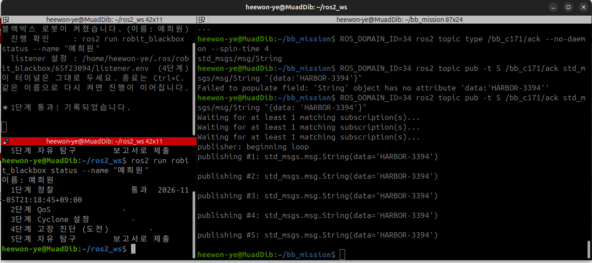

# 과제 1

+ 로봇이 어느 도메인에서 bb_ 토픽을 방해하는지 모르는 상태에서 그 도메인을 찾고, telemetry 메세지의 챌린지 단어를 /bb_c171/ack 로 보낸다.

## 사용된 개념
+ ROS2는 ROS_DOMAIN_ID가 다르면 서로 발견하지 못한다.
+ 도메인마다 발견용 포트가 다르기 때문이다. 포트는 7400 + 250 * 도메인 으로 정해진다.
+ 기본 도메인에서는 로봇 토픽이 보이지 않는다. 그래서 도메인을 하나씩 바꿔가며 topic list를 확인하는 스캔이 필요하다.


+ 스캔 스크립트
```bash
#!/bin/bash
for d in $(seq 10 95); do
  echo -n "domain $d ... "
  t=$(ROS_DOMAIN_ID=$d ros2 topic list --no-daemon --spin-time 4 2>/dev/null | grep bb_)
  if [ -n "$t" ]; then echo "FOUND"; echo "$t"; else echo "-"; fi
done
```
+ --no-daemon : 데모 캐시에 남은 예전 결과를 없애고 업데이트하기 위해 사용한다.
+ --spin-time 4 : 발견이 끝날 때까지 4초 기다린다.
## 시행 착오
+ 처음 스캔을 실행했을 때 FOUND가 하나도 나오지 않았다.
+ 원인 : env | grep -E "ROS|RMW|CYCLONE"으로 확인해 보니 터미널에 RWM_IMPLEMENTATION=rmw_cyclonedds_cpp와 존재하지 않는 파일을 가리키는 CYCLONEDDS_URI가 남아 있었다. (교재에 있는 코드 쳐보면서 공부하다가 들어감)
+ 해결 : 
```bash
unset RMW_IMPLEMENTATION CYCLONEDDS_URI
ros2 daemon stop
```
+ 배운점 : 결과가 비어 있으면 "정말 없는 것"인지 "명령이 실패한 것"인지 먼저 구분해야한다.

## 스캔 결과
```bash
#scan_result.txt 참고
31: /bb_c171/cmd
32: /bb_c171/command
34: /bb_c171/ack, /bb_c171/telemetry
94: /bb_c171/answer, /bb_c171/config, /bb_c171/stream
```

## 메세지 확인
+ 처음에는 ros2 topic echo가 "does not appear to be published yet"이라며 실패했다. 데몬이 아직 토픽을 발견하지 못했기 때문이다. 그래서 타입을 먼저 확인한 뒤 echo에 타입을 직접 적었다.
```bash
ROS_DOMAIN_ID=34 ros2 topic type /bb_c171/telemetry --no-daemon --spin-time 4
ROS_DOMAIN_ID=34 ros2 topic echo /bb_c171/telemetry std_msgs/msg/String
```
출력 :
```
BB1 pos=(0.03,-0.30) | 챌린지: HARBOR-3394 | 이 단어를 그대로 /bb_c171/ack 로 보내라 | 다음 신호: 도메인 94
```

## 응답 전송
``` bash
ROS_DOMAIN_ID=34 ros2 topic pub -t 5 /bb_c171/ack std_msgs/msg/String "{data: 'HARBOR-3394'}"
```
+ -t 5 : 5번 보내고 끝낸다. 한 번만 보내면 상대가 나를 발견하기 전에 메세지가 지나가 버릴수 있기 때문이다
+ 결과 : 로봇 터미널에 1단계 통과가 표시됐다.



## 아직 이해 못 한것
sh 문법을 아직 잘 모르겠습니다.