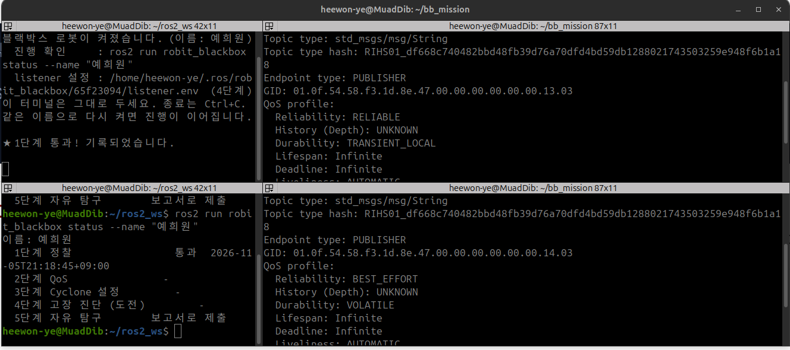
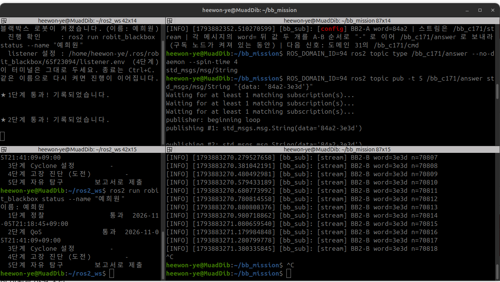

# 과제2 

도메인 94의 /bb_c171/config와 /bb_c171/stream 에서 각각 단어를 받아 단어A/단어B 형식으로 /bb_c171/answer에 보낸다.

## 발행자 Qos 조사
+ Qos를 맞추려면 먼저 상대가 어떤 Qos로 발행하는지 알아야 한다.
```bash
ROS_DOMAIN_ID=94 ros2 topic info -v /bb_c171/config --no-daemon --spin-time 4
ROS_DOMAIN_ID=94 ros2 topic info -v /bb_c171/stream --no-daemon --spin-time 4
```


| 토픽 | Reliability | Durability | 특징 |
|---|---|---|---|
| config | RELIABLE | TRANSIENT_LOCAL | 설정값. 한 번 보내고 보관해 둔다 |
| stream | BEST_EFFORT | VOLATILE | 계속 흘러가는 데이터. 빠짐을 허용한다 |

## Qos를 맞춰야 하는 이유
Qos 규칙은 "제공하는 정보의 품질 >= 요청하는 정보의 품질"이라는 것이다.
+ stream : 발행자가 BEST_EFFORT인데 구독자가 기본값인 RELIABLE을 요청하면, 요청이 제공보다 높아서 짝이 지어지지 않는다. 그래서 구독자도 BEST_EFFORT로 맞춰주었다.
+ config: 발행자가 TRANSIENT_LOCAL로 마지막 값을 보관한다. 하지만 구독자가 VOLATILE이면 연결은 되더라도 연결되기 전에 보내진 값은 받지 못한다. 그래서 구독자도 TRANSIENT_LOCAL로 맞췄다. 이렇게 하면 늦게 켜지더라도 보관된 값을 받을 수 있다. <br>

ros2 topic echo로 하나씩 받을 수도 있지만, 두 토픽의 Qos가 서로 달라서 각각을 맞춘 구독 노드를 직접 만들었다.

## 구독 노드
bb_sub.py
```bash
config_qos = QoSProfile(depth=1, reliability=ReliabilityPolicy.RELIABLE,
                        durability=DurabilityPolicy.TRANSIENT_LOCAL)
stream_qos = QoSProfile(depth=10, reliability=ReliabilityPolicy.BEST_EFFORT,
                        durability=DurabilityPolicy.VOLATILE)
```
실행 코드 :
```bash
ROS_DOMAIN_ID=94 python3 ~/bb_mission/bb_sub.py 2>&1 | tee sub_log.txt
```

## 시행 착오
+ stream 메세지가 계속 출력되어서 config 줄이 화면에서 밀려 보이지 않았다(config는 처음에 한번만 오기 때문).
+ tee로 출력을 sub_log.txt에도 저장하게 한 뒤 다시 실행해서 config 줄을 확인했다.

## 받은 메세지
```bash
[config] BB2-A word=84a2 | ... | 다음 신호: 도메인 31의 /bb_c171/cmd
[stream] BB2-B word=3e3d ...
```

## 매칭 확인

```
$ ROS_DOMAIN_ID=94 ros2 topic info -v /bb_c171/stream --no-daemon --spin-time 4
Type: std_msgs/msg/String

Publisher count: 1

Node name: bb_s2
Node namespace: /
Topic type: std_msgs/msg/String
Topic type hash: RIHS01_df668c740482bbd48fb39d76a70dfd4bd59db1288021743503259e948f6b1a18
Endpoint type: PUBLISHER
GID: 01.0f.54.58.f3.1d.8e.47.00.00.00.00.00.00.14.03
QoS profile:
  Reliability: BEST_EFFORT
  History (Depth): UNKNOWN
  Durability: VOLATILE
  Lifespan: Infinite
  Deadline: Infinite
  Liveliness: AUTOMATIC
  Liveliness lease duration: Infinite

Subscription count: 1

Node name: bb_sub
Node namespace: /
Topic type: std_msgs/msg/String
Topic type hash: RIHS01_df668c740482bbd48fb39d76a70dfd4bd59db1288021743503259e948f6b1a18
Endpoint type: SUBSCRIPTION
GID: 01.0f.54.58.1a.36.18.70.00.00.00.00.00.00.14.04
QoS profile:
  Reliability: BEST_EFFORT
  History (Depth): UNKNOWN
  Durability: VOLATILE
  Lifespan: Infinite
  Deadline: Infinite
  Liveliness: AUTOMATIC
  Liveliness lease duration: Infinite
```

발행자 bb_s2와 구독자 bb_sub 모두 Reliability가 BEST_EFFORT, Durability가 VOLATILE이고, type hash도 같다.

## 응답 전송
```bash
ROS_DOMAIN_ID=94 ros2 topic pub -t 5 /bb_c171/answer std_msgs/msg/String "{data: '84a2-3e3d'}"
```



## 이해 못한 것
없음