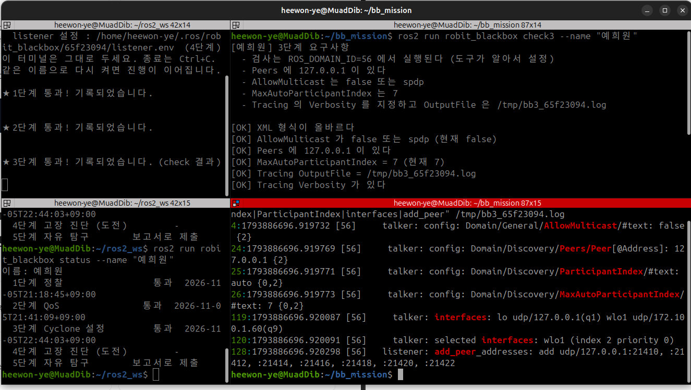

# 과제3
check3가 알려 준 요구사항을 맞춰 ~/cyclonedds_bb.xml을 작성하고, 구조 점검과 통신 테스트를 통과해야한다.

## 요구사항 확인
```bash
ros2 run robit_blackbox check3 --name "예희원"
```
```bash
[예희원] 3단계 요구사항
  - 검사는 ROS_DOMAIN_ID=56 에서 실행된다 (도구가 알아서 설정)
  - Peers 에 127.0.0.1 이 있다
  - AllowMulticast 는 false 또는 spdp
  - MaxAutoParticipantIndex 는 7
  - Tracing 의 Verbosity 를 지정하고 OutputFile 은 /tmp/bb3_65f23094.log

[NG] 설정 파일이 없습니다: /home/heewon-ye/cyclonedds_bb.xml
```

## xml 작성
요소의 이름과 위치는 Cyclone DDS 공식 문서에서 찾았다.
```bash
<?xml version="1.0" encoding="UTF-8"?>
<CycloneDDS xmlns="https://cdds.io/config">
  <Domain Id="any">
    <General><AllowMulticast>false</AllowMulticast></General>
    <Discovery>
      <Peers><Peer address="127.0.0.1"/></Peers>
      <ParticipantIndex>auto</ParticipantIndex>
      <MaxAutoParticipantIndex>7</MaxAutoParticipantIndex>
    </Discovery>
    <Tracing>
      <Verbosity>config</Verbosity>
      <OutputFile>/tmp/bb3_65f23094.log</OutputFile>
    </Tracing>
  </Domain>
</CycloneDDS>
```
| 설정 | 문서 위치 | 의미 |
|---|---|---|
| `AllowMulticast=false` | `//CycloneDDS/Domain/General` | 멀티캐스트로 "누구 있어요?" 하고 외치지 않는다 |
| `Peer address=127.0.0.1` | `//CycloneDDS/Domain/Discovery/Peers` | 멀티캐스트 대신 이 주소에 직접(유니캐스트) 물어본다 |
| `ParticipantIndex=auto` | `//CycloneDDS/Domain/Discovery` | 참가자 번호를 자동으로 정한다 |
| `MaxAutoParticipantIndex=7` | `//CycloneDDS/Domain/Discovery` | 자동 번호의 최대값을 정한다. 피어에게 물어볼 포트 범위가 여기서 정해진다 |
| `Verbosity`, `OutputFile` | `//CycloneDDS/Domain/Tracing` | 설정과 동작 기록을 로그 파일로 남긴다 |

## 이 설정이 필요한 이유
+ 기본 Discovery는 멀티캐스트(239.255.0.1)로 같은 네트워크의 모두에게 알린다. 그래서 멀티캐스트를 끄면 아무도 찾지 못한다.
+ 그래서 Peers에 상대 주소를 직접 적어 유니캐스트로 찾게 했다.
+ 그런데 상대가 어느 포트에 있는지는 참가자 번호에 따라 달라진다. 그래서 ParticipantIndex와 maxAutoParticipantIndex로 번호 범위를 정해, 그 범위의 포트들에 물어보게 했다.
+ 포트 계산(도메인 56)을 하게 되면 21410, 21412, 21414 ....이 된다.

## 통과 결과


## 로그에서 찾은 근거
```bash
grep -nE "AllowMulticast|Peer|MaxAutoParticipantIndex|ParticipantIndex|interfaces|add_peer" /tmp/bb3_65f23094.log
```
```bash
4:   talker: config: Domain/General/AllowMulticast/#text: false {2}
24:  talker: config: Domain/Discovery/Peers/Peer[@Address]: 127.0.0.1 {2}
26:  talker: config: Domain/Discovery/MaxAutoParticipantIndex/#text: 7 {0,2}
119: talker: interfaces: lo udp/127.0.0.1(q1) wlo1 udp/172.100.1.60(q9)
120: talker: selected interfaces: wlo1 (index 2 priority 0)
135: talker: add_peer_addresses: add udp/127.0.0.1:21410, :21412, :21414, :21416, :21418, :21420, :21422
```
+ 4, 24, 26: xml을 실제로 읽혀서 적용되었다. [56]은 도메인 56에서 실행됐다는 뜻이다.
+ 119, 120 : 사용할 수 있는 인터페이스는 lo(127.0.0.1)와 wlo1(와이파이)였고, Cyclone은 wlo1을 선택했다.
+ 135 : 피어 127.0.0.1의 21410~21422 포트 7개(참가자 번호 0~6)에 물어본다. MaxAutoParticipantIndex가 7인데 7개인 이유는, 설치된 Cyclone 0.10.5 소스(q_addrset.c)의 반복문이 `i < maxidx`라서 7번이 빠지기 때문이다.

## 아직 이해 못한 것

Peer를 127.0.0.1로 지정했는데 선택된 인터페이스는 lo가 아니라 wlo1이었다. 그런데도 통신이 되는 이유를 정확히 모르겠다.